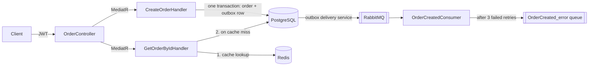

# OrderService

[](https://github.com/baharagayeva/OrderApp/actions/workflows/ci.yml)

An order management API built with **.NET 10** and **ASP.NET Core**. It uses CQRS with MediatR, JWT authentication, PostgreSQL, event-driven messaging with RabbitMQ and MassTransit (retries, an error queue and a transactional outbox) and Redis caching. The whole stack runs locally with Docker Compose.

## Tech stack

| Area         | Technologies                                                                       |
|--------------|------------------------------------------------------------------------------------|
| API          | ASP.NET Core Web API (.NET 10), Swagger / OpenAPI                                  |
| Architecture | CQRS with MediatR                                                                  |
| Data         | PostgreSQL 16, Entity Framework Core 10, migrations                                |
| Messaging    | RabbitMQ, MassTransit 8 (message retry, error queue, EF Core transactional outbox) |
| Caching      | Redis 7, `IDistributedCache` (cache-aside)                                         |
| Security     | JWT bearer authentication                                                          |
| Observability| Serilog, ProblemDetails, TraceId                                                   |
| DevOps       | Multi-stage Dockerfile, Docker Compose, GitHub Actions CI                          |
| Testing      | xUnit, Moq, EF Core InMemory provider     
Background jobs | Hangfire (PostgreSQL storage, recurring and fire-and-forget jobs)|

## Architecture



**Writing an order.** `CreateOrderHandler` saves the order and the `OrderCreatedEvent` in a single database transaction. The event is stored in the outbox table first, and a MassTransit background service delivers it to RabbitMQ. If RabbitMQ is down, the order is still saved and the event is delivered once the broker is back. This solves the dual-write problem between the database and the message broker.

**Consuming the event.** `OrderCreatedConsumer` processes the event. A failing message is retried 3 times with a 2-second interval. If every attempt fails, MassTransit moves the message to the `OrderCreated_error` queue, where it can be inspected and reprocessed. `ArgumentException` is treated as a permanent error and is not retried.

**Reading an order.** `GetOrderByIdHandler` uses the cache-aside pattern. It checks Redis first and only queries PostgreSQL on a cache miss, then stores the result with a 10-minute TTL. Missing orders are not cached.

## Getting started

### Prerequisites

- Docker Desktop
- .NET 10 SDK and the EF Core CLI tool (`dotnet tool install --global dotnet-ef`), used to create the database schema

### Run

```bash
git clone https://github.com/baharagayeva/OrderApp.git
cd OrderApp

# Start the API, PostgreSQL, RabbitMQ and Redis
docker compose up --build -d

# Create the database tables (first run only)
cd OrderService
dotnet ef database update
```

| Service | URL |
| --- | --- |
| Swagger UI | http://localhost:8080/swagger |
| RabbitMQ management | http://localhost:15672 (user `admin`, password `Admin123`) |
| PostgreSQL | `localhost:5432`, database `orderdb` |
| Redis | `localhost:6379` |

To run the API from an IDE instead, start only the infrastructure with `docker compose up -d postgres rabbitmq redis`.

## Try it out

1. **Get a token.** Call `POST /api/Auth/login?username=demo` and copy the `token` from the response.
2. **Authorize.** Click **Authorize** in Swagger and paste the token.
3. **Create an order.** Call `POST /api/Order/CreateOrder`:

   ```json
   { "name": "Laptop", "totalPrice": 1200, "discount": 100 }
   ```

   The API logs show the consumer processing the event.
4. **Read it twice.** Call `GET /api/Order/GetOrderById?OrderId=1` two times. The logs show `Cache MISS` and then `Cache HIT`.
5. **See the retry and error queue.** Create an order whose name contains `fail`, for example `"name": "fail-test"`. The consumer throws on purpose. The logs show attempts 0 to 3, and the message then appears in the `OrderCreated_error` queue in the RabbitMQ management UI.
6. **See the outbox.** Stop the broker with `docker compose stop rabbitmq` and create an order. The API still succeeds, and the event waits in the `OutboxMessage` table. Start the broker again with `docker compose start rabbitmq` and the event is delivered within a few seconds.
7. **Generate a report.** Call `POST /api/Report/daily?date=2026-10-28` and open http://localhost:8080/hangfire to see the job run. The nightly `daily-sales-report` recurring job is listed under **Recurring Jobs**.

## API

| Method | Endpoint | Auth | Description |
| --- | --- | --- | --- |
| `POST` | `/api/Auth/login?username={name}` | No | Returns a JWT valid for 1 hour |
| `POST` | `/api/Order/CreateOrder` | Yes | Creates an order and publishes `OrderCreatedEvent` |
| `GET` | `/api/Order/GetOrderById?OrderId={id}` | Yes | Returns an order, served from Redis when cached |
| `POST` | `/api/Report/daily?date={yyyy-MM-dd}` | Yes | Queues a Hangfire job that generates the daily sales report for the given date and returns `202 Accepted` with the job ID |

## Project structure

```
OrderService/
├── Configurations/   AppDbContext and EF Core entity configuration
├── Consumers/        MassTransit consumers
├── Controllers/      Auth and Order API endpoints
├── CQRS/             Commands, queries and their MediatR handlers
├── Entities/         Domain entities
├── Events/           Integration event contracts
├── Migrations/       EF Core migrations, including the outbox tables
└── Program.cs        Service registration and middleware pipeline
OrderService.Tests/   xUnit tests for the command handlers
```

## Tests

```bash
dotnet test
```

The tests use the EF Core InMemory provider and mock MassTransit's `IPublishEndpoint` with Moq, so they need neither PostgreSQL nor RabbitMQ. GitHub Actions builds the project and runs the tests on every push to `main`.

## Notes

- This is a learning and portfolio project. The credentials and the JWT signing key in `appsettings.json` and `docker-compose.yml` are for local development only. In production they belong in environment variables or a secret manager such as HashiCorp Vault.
- The login endpoint issues a token for any username. It demonstrates JWT validation, not user management.

## Possible next steps

- Consumer tests with the MassTransit test harness
- Apply EF Core migrations automatically at startup in development
- Update and delete endpoints with cache invalidation